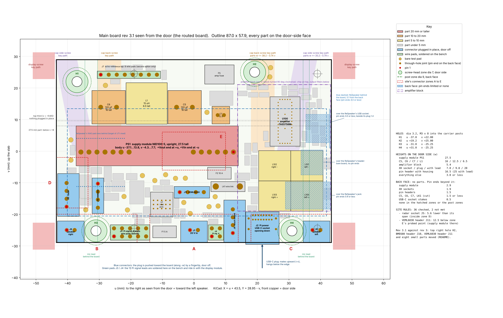

# Main board rev 3.1 — block 1: the layout (2026-11-11)

Electronics session, step 2 repeated (`claude/brief-electronics-step2-repeat-2026-11-11.md`).
Block 0 (the change list shown at the checkpoint): `block0.md`. Positions are in the site's board frame, seen from the
door: **u** to the right, **v** up, mm.

**Checkpoint. The board is changed, routed and checked. It is a draft like everything else until the whole unit is shown
to be buildable. No fab files, no stencil, no basket or order list touched, nothing on `main`.**
Not done yet (block 2): the reply to the enclosure, `MAIN_env.md`, `gpio-leads.md`, the STEP files.

## 1. Answer
- **Rev 3.1 is `../main-board.kicad_pcb`.** Rev 3 is kept as `../rev3/main-board-rev3.kicad_pcb` (and in commit `03ad1f9`).
- **Schematic check: 0 errors, 0 warnings. Board check with schematic comparison: 0 errors, 0 open connections,
  0 differences, 2 warnings** (the same two as on rev 3: the outlines of the USB-C socket and the touch socket are trimmed
  at the board edge).
- **Site rules: 36 checked, 34 met, 2 not met.** The two are the ones accepted with the rev 3 floor plan (radar socket
  below its lead span; VEML6030 header below the probed point). The top right hole is tested against the new zone.
- **Hand-assembly rules kept:** 120 parts, all on the door-side face; chip sizes 0603, 0805, 1206, 2920; 16 through-hole
  parts (the connectors, the supply module, three capacitors, the wire link).
- **11 parts moved, 109 did not.** 87 % of rev 3's track length is unchanged. No track of the amplifier changed.
- **The Pi's 5 V: board copper 4.8 mΩ** (rev 3: 7.2). No segment above 16 K at 5 A.
- **Three small differences from what was shown at the checkpoint:** section 3.

## 2. What moved, old → new
| Part | What | Rev 3 (u, v) | Rev 3.1 (u, v) |
|---|---|---|---|
| H2 | top right hole | +30.00, +25.00 | **+19.20, +25.00** |
| J10 | BME680 header, pin 1 (pins run down to v −17.92) | −34.30, −10.30 | **−30.40, −10.30** |
| J11 | VEML6030 header, pin 1 (pins run to u +3.12) | −4.50, −12.00 | **−4.50, −13.00** |
| R26 | link that feeds the amplifier's logic supply | +20.00, +23.50 | +21.90, +20.20, turned half round |
| R27 | its alternative, not fitted | +20.00, +25.50 | +18.20, +20.20 |
| F3 | radar fuse | −27.00, −19.50 | −34.24, −11.20, upright |
| C10 | radar capacitor | −31.01, −15.61 | −34.24, −16.10, turned flat |
| TP12 | radar test pad | −30.75, −11.65 | −34.24, −18.60 |
| F4 | sensor fuse | −27.19, −14.45 | −26.09, −14.45 |
| C11 | regulator input capacitor | −27.68, −7.25 | −27.32, −7.25 |
| TP3 | inlet current test pad | −3.22, −15.77 | −3.22, −16.27 |

- **Hole:** 3.2 across. Clear zones 7 across on the door side and 9 across on the back. No copper within 3.5 of its
  centre on the door side and within 4.1 on the back, as at the other three holes. The old hole and its keep-out circles are gone.
- **BME680 header:** box u −32.22…−28.58. Between the boxes of the radar socket and the header: 4.14 (rev 3: 0.24),
  3.90 more. To the supply module: 3.89, unchanged.
- **VEML6030 header:** 1.00 lower. Box v −14.81…−11.19.
- **Nothing else moved:** the outline, holes H1, H3, H4, every socket, the wire pads, the supply module, the 20 V
  filter, the amplifier (`check/compare_rev3_result.txt`).

## 3. Different from the checkpoint, and why
1. **Hole at u +19.2, not +19.5.** At +19.5 the outlines of the two test pads beside it reached up to 0.24 into the
   7 mm circle (the pads themselves stayed 0.5 clear). At +19.2 nothing does.
2. **BME680 header 3.9 further, not 4.0.** At 4.0 the regulator's input capacitor had 0.08 left between the header and
   the regulator chip. At 3.9 it has 0.15 and 0.13. The request was 3.7 or more.
3. **R26 and R27 sit below the hole, not beside it:** next to the capacitor they feed. Their track to it is 1.3 long.

## 4. Tracks
- **Taken out 270 mm, laid new 259 mm, of 2137 mm.** Nets touched: the two I2C lines, the sensor 3.3 V, the Pi's 3.3 V
  sense line, the audio bit clock, amplifier mute, the radar's two data lines and its 5 V, audio data in, 3.3 V, the
  amplifier's logic rail, the inlet current monitor, the regulator input. Per net: `check/compare_rev3_result.txt`.
- **How:** only the tracks that ended on a moved part or ran into a new position were taken out, and only as far as
  needed; the repository's router joined the ends again. 34 connections routed, none left open, none narrower than its class.
- **The audio bit clock** no longer runs round the old hole on the back (15 pieces removed, 5 mm shorter).
- **Not touched:** the amplifier's copper, the right speaker's pair on the back, the supply tracks apart from section 5.
- **Vias:** 198 → 245 (12 taken out, 59 added). Ground vias 49 → 92: of the 44 added, 42 are stitching for the pours
  and 2 are at moved parts; 1 was taken out.

## 5. Supply copper
Same method as block 0 (`check/rnet.py`, `check/pi5v_board.py`; IPC-2221 for the rise).

**The Pi's 5 V path, board copper, mΩ at 20 °C:**

| Segment | Rev 3 | Rev 3.1 | What changed |
|---|---|---|---|
| Supply module → fuse | 1.02 | 1.02 | nothing |
| Fuse → wire link | 0.71 | 0.53 | track 1.5 → 2.2 wide |
| Wire link → socket | 3.80 | 2.24 | a copper area on the back round the old tracks: 3.1 wide down from the link, 2.05 wide along the pin row, 1.0 wide at each pin pair; pin-to-pin links 0.4 → 0.7 |
| Return | 1.66 | 1.03 | the ground pours |
| **Board copper** | **7.2** | **4.8** | |
| With the fuse (5.6) and the wire link (0.17) | 13.0 | 10.6 | |
| Drop in the copper at 5 A | 36 mV | 24 mV | |
| Drop in the copper at 2.3 A | 17 mV | 11 mV | |

Rise at 5 A: 8 K (3.1 wide), 16 K (2.05 wide), 15 K (fuse to link), 11 K at each pin pair with the current shared.
The budget of 2026-11-02 assumed 4 mΩ; the board is 0.8 above it.

**20 V:**

| Segment | Rev 3 | Rev 3.1 | Rise |
|---|---|---|---|
| Socket → fuse | 2.04 mΩ, 1.0 wide | 1.06 mΩ, 2.0 wide | 8 K at 3.5 A |
| Fuse → protection chip | 2.66 mΩ, 0.6 wide | 0.99 mΩ, a copper area 1.6 wide at its narrowest | 7 K at 2.83 A, 11 K at 3.5 A |
| Protection chip → filter coil (layer 3) | 3.54 mΩ | 3.68 mΩ | the stitching vias pass through this area |
| Filter coil → supply module | 5.27 mΩ | 5.27 mΩ | unchanged |

## 6. Ground pours
- **Door side 60 % of the board, back 66 %** (rev 3: none). Thermal spokes at ground pads, 0.3 clear of other copper.
  Picture: `pours.png`.
- 42 stitching vias, one for every poured piece that had no via into the ground plane; pieces that still have none are removed.
- The four holes' circles are bare on both faces.
- The right speaker's pair, the Pi's 5 V and the 20 V track on the back now have ground on both sides.

## 7. Silkscreen
- On the back: "REV 3.1 2026-11-11"; the names BME680 and VEML6030 moved with their headers.
- Five part names are hidden because a pad or another name now lies there: F3, C120, R26, C114, R8. 53 of 120 are now
  hidden; the assembly drawing in step 5 has to carry them.

## 8. Checks, with the numbers
| Check | Result | Where |
|---|---|---|
| Schematic check | 0 errors, 0 warnings | `../erc-report.txt` |
| Board check with schematic comparison | 0 errors, 0 open, 0 differences, 2 warnings | `../drc-report.txt` |
| Site rules | 36 checked, 34 met, 2 not met (accepted) | `site-rules.md` |
| H2 in the new zone | u +19.20, v +25.00 in u −12.0…+22.7, v +21.6…+25.5; nearest display mounting point 19.9 | `site-rules.md` rule 5 |
| Clear zones at the four holes | nearest part outline 0.01 outside the 7 mm circle; nearest through-hole pad 0.10 outside the 9 mm circle | rules 8, 9 |
| Back-face pin ends over the display's power lead | J5 and J9 1.9, C5 and C6 1.5; 4.0 allowed | rule 33 |
| BME680 header | 3.90 further from the radar socket; 3.89 to the supply module as before | rule 34 |
| VEML6030 header | 1.00 lower | rule 35 |
| What had to stay | 11 of 120 parts moved, none of the fixed ones | rule 36 |
| Hand assembly | all on the door side; nothing under 0603; connectors through-hole | `check/hand_assembly_rev3.1_result.txt` |
| Repeatable | two runs of the script give the same copper | `gen/rev31.sh` |

## 9. Deviations from the brief
1. The three of section 3.
2. The 20 V inlet was widened although the brief did not list it (Daniel's go-ahead, 2026-11-11 20:52).
3. The ground pours and their stitching vias are new copper over the whole board (Daniel's decision 1).
4. The schematic files changed in one line each: the revision text.

## 10. Open, for block 2 or later
- The enclosure probes the reach again; the two rules that are not met rest on that probe.
- The stitching vias were placed for the pours only. 15 of them pass through the 20 V area on layer 3 and raise it by 0.14 mΩ.
- `NOTES.md` section 7 still describes the rev 2.1 layout.

## 11. Tool lessons
1. **The router's result depended on Python's hash seed.** `rev31.sh` sets `PYTHONHASHSEED=0`; two runs now agree.
2. **Following a track to its next joint takes out far too much** (30 % of the board's tracks in the first try, and one
   net could not be laid again). Taking out only the piece KiCad's check reports, and letting the router join the ends,
   left 87 % untouched.
3. **Rev 3's pours were lost twice over:** the routing script did not save after its last stage, and its pour was drawn
   over rev 2.1's outline. Both are corrected in `gen/route_rev3.py`.
4. **A pour filled with "remove unconnected pieces" on leaves most of the board bare.** Fill with the pieces kept,
   give each a via, then remove what still has none.
5. **The loose-end pass leaves track pieces of no length.** They are removed last, except on the amplifier's nets.

## 12. Files
| File | What |
|---|---|
| `../main-board.kicad_pcb`, five `.kicad_sch` | rev 3.1 |
| `../rev3/main-board-rev3.kicad_pcb` | rev 3, the input of the script |
| `../gen/rev31.py`, `../gen/rev31.sh` | the changes, stage by stage; `rev31-run.txt` is the log of the run that made the board |
| `../erc-report.txt`, `../drc-report.txt`, `../main-board-schematic.pdf` | checks and schematic of rev 3.1 |
| `../main-board-3d-door-side.png`, `../main-board-3d-back.png`, `../main-board-copper-F-B.png`, `pours.png` | pictures of rev 3.1 |
| `floorplan.json`, `floorplan.png`, `site-rules.md`, `floorplan-tables.md` | the plan read back from the board, and the site check |
| `plan_from_board.py`, `sitecheck.py`, `sitedata.py` | how they are made (the site data carries the new hole zone) |
| `check/` | the calculations of block 0 and block 1 with their output |
| `block0.md`, `block0-planned-changes.png` | the change list as shown at the checkpoint |
