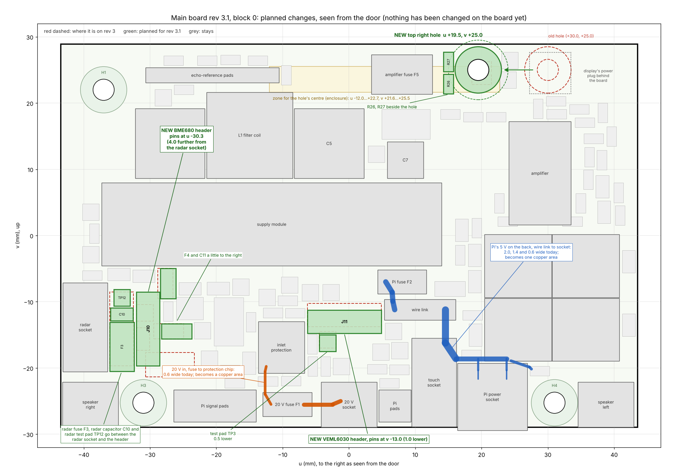

# Main board rev 3.1 — block 0: reading and change list (2026-11-11)

Electronics session, step 2 repeated (`claude/brief-electronics-step2-repeat-2026-11-11.md`). It follows the enclosure's
findings on rev 3 (`claude/main-board-rev3-enclosure-findings-2026-11-11.md`).
Positions are in the site's board frame, seen from the door: **u** to the right, **v** up, mm.

**This is the change list as shown at the block 0 checkpoint (commit `29f2f31`), kept as the record of what was
proposed. The board as built is in `README.md`; where the two differ, `README.md` governs** (hole at u +19.2 instead of
+19.5; BME680 header 3.9 instead of 4.0; R26 and R27 below the hole instead of beside it).
Daniel's answers (2026-11-11 20:44 and 20:52): decision 1 = add the ground pour; decision 2 = go-ahead with everything
listed, the 20 V inlet included.

At the checkpoint nothing had been changed on the board: `main-board.kicad_pcb` was rev 3 (`03ad1f9`).

## 1. Answer
- **All three requests can be met as asked.** No dimension is missing.
- **The three new positions:** section 2.
- **The Pi's 5 V copper: sound against rev 2.1, not sound enough to leave.** The board's share is 7.2 mΩ
  (rev 2.1: 26.7; the power budget assumed 4). Three short segments calculate to 26 to 31 K of rise at 5 A.
  I widen them in block 1; expected share about 5 mΩ. Section 4.
- **Two things found while checking that nobody asked about:**
  1. Rev 3 has **no ground pour on either outer layer**, although my reply to the enclosure says it has. My mistake. Decision 1.
  2. The **20 V inlet has a neck 0.6 wide** that carries the whole unit's current. Planned to be widened with the 5 V copper.
- **Schematic:** no change (the revision text only).
- **Nothing else has to move.** No connector that the brief lists as fixed is touched.

## 2. The three positions
| Item | Rev 3 | Rev 3.1, planned | Asked |
|---|---|---|---|
| Top right hole H2, centre | u +30.00, v +25.00 | **u +19.50, v +25.00** | u −12.0…+22.7 (preferably +20.0 or less), v +21.6…+25.5 |
| BME680 header J10, pins | u −34.30, v −10.30…−17.92 | **u −30.30**, v −10.30…−17.92 | at least 3.7 further from the radar socket; no closer to the supply module |
| VEML6030 header J11, pins | u −4.50…+3.12, v −12.00 | u −4.50…+3.12, **v −13.00** | 0.5 to 2.0 lower, aim for 1.0 |

### 2.1 Top right hole
- Hole 3.2. Clear zones 7 across on the door side and 9 across on the back. Copper-free circles 3.5 radius on the door
  side and 4.1 radius on the back: the full figures of the other three holes, so the post's 8 mm face sits on bare board.
- The post's edge is 3.75 from the assumed box of the display's power plug (0.5 needed). The plug may be 3.2 larger on
  that side than assumed.
- Same height as the old hole: 3.95 from the top edge to the hole's centre. Nearest display mounting point 19.6 away (7.0 needed).
- Why +19.5 and not +20.0: at +19.5 the two test pads TP19 and TP20 stay where they are.
- **Moves with it:**
  - R26 (the link that feeds the amplifier's logic supply) and R27 (its alternative, not fitted): about 5 to the left,
    between the amplifier fuse F5 and the hole, turned upright.
  - Tracks: the three at R26 and R27, and one track on the back (the audio bit clock) that crosses the new copper-free circle.
  - The amplifier's supply area on layer 3 gets an opening for the hole. Its path from the fuse to the amplifier does
    not pass the hole.
  - The old hole and its keep-out circles go. That corner stays empty.

### 2.2 BME680 header
- Box u −32.12…−28.48 (was −36.12…−32.48). Between the boxes of the radar socket and the header: **4.2 (was 0.2)**.
- To the supply module: 3.9, unchanged (v is unchanged).
- Why 4.0 and not 3.7: 0.3 of margin on a limit that was probed, without pushing further into the parts of the
  3.3 V regulator beside it. The enclosure probed 3.7 and 5.0 with the same result.
- **Moves with it:**
  - The radar's three small parts go into the 4.2 strip between the socket and the header: fuse F3 (turned upright),
    capacitor C10, test pad TP12. The tallest is 2.9; the radar plug's top is at 9.8.
  - Sensor fuse F4 about 1.2 to the right; capacitor C11 about 0.4 to the right.
  - Tracks: the radar's 5 V feed and 5 V line, the four lines at the header, the radar's two data lines, one ground via.
- **For the enclosure:** the header's pin ends (1.5) move from the middle of the −u microphone strip to its +u edge
  (pins at u −30.3; strip u −34.5…−30.5). The header leaves the drawn box of zone D (u −33.5 or less) by 3.2; the rule
  table tests v only, which is unchanged. The BME680 lead grows by about 4.

### 2.3 VEML6030 header
- Box v −14.81…−11.19 (was −13.81…−10.19). To the 20 V socket's box: 7.3 (was 8.3). To the supply module: 6.6 (was 5.6).
- **Moves with it:** test pad TP3 (inlet current monitor) 0.5 lower. Tracks: the four at the header and two that pass
  under the new pin row (amplifier mute, audio data in).

### 2.4 What is checked now and what is not
- Checked on the planned positions: no part outline overlaps another (tightest gap 0.1, C11); nothing inside the
  clear zones of any hole; nothing outside the board outline (`check/plan_check.py`).
- The positions of the small parts are plans. The final list, old → new, comes with block 1.
- Not checked: that it routes. That is block 1.

## 3. What stays
The outline; holes H1, H3, H4; the 20 V socket, Pi power socket, radar socket, touch socket and both speaker sockets;
the wire pads J3, J4, J7; the supply module, the 20 V filter, the amplifier and its copper. None of them has to move.

## 4. The Pi's 5 V path
**Method.** Resistance is calculated from the copper in the board file (tracks, pads, filled areas, plated holes) by a
finite-difference solve on a 0.05 mm grid (`check/rnet.py`).
- Copper 1.724 × 10⁻⁸ Ω·m at 20 °C. Stack-up JLC04161H-7628: outer layers 35 µm, inner layers 15.2 µm (JLC's
  finished figure for 0.5 oz), hole wall 18 µm.
- The solver is within 0.3 % of ρ·L / (w·t) on a straight track.
- The current is taken as shared equally by the socket's four supply pins and by its four ground pins.
- Temperature rise: IPC-2221, I = k·ΔT^0.44·A^0.725 (k = 0.048 on an outer layer, A in square mils). The formula is for a
  long track with no plane near it, so it is an upper bound for these short segments.

**The path on rev 3**, from the supply module's output pins to the USB-C socket's supply pins:

| # | Segment | Layer | Width | Length | Vias | mΩ at 20 °C |
|---|---|---|---|---|---|---|
| 1 | Supply module pins 1 to 4 → 5 V area → fuse F2 | layer 3 area, then door side | area 11.2; four stubs 0.8 | 4.4 to 7.6 in the area; stubs 1.2 | 4 of 0.4 hole, in parallel | 1.02 |
| 2 | Fuse F2 (10 A, 0453010.MR) | part | | | | 5.6 (Littelfuse, cold) |
| 3 | Fuse F2 → wire link | door side | 1.5 | 4.5 between pad centres, 1.3 between the pads | 0 | 0.71 |
| 4 | Wire link LK1 (1.0 mm copper wire) | part | | 7.62 | | 0.17 |
| 5 | Wire link → the socket's four supply pins | back | 2.0, then 1.4, then a neck 0.6 into each pin pair and a link 0.4 from pin to pin | 7.9; 7.6 (3.4 with all the current, 4.25 with half); necks 1.75 (0.7 between copper edges); links 1.35 (0.65) | 0 | 3.80 |
| 6 | Return: the socket's four ground pins → ground plane → module pins 5 to 8 | layer 2, unbroken plane | plane | 26 to 30 | pins only | 1.66 |
| | **Board copper (1 + 3 + 5 + 6)** | | | | | **7.2** |
| | Module pins to socket pins with fuse and link | | | | | 13.0 |

**Against rev 2.1 and the budget** (`claude/E0-power-budget-2026-11-02.md`, section 3.2):

| | Rev 3 | Rev 2.1 | Budget |
|---|---|---|---|
| Module → fuse | 1.02 | 6.91 (one via of 0.3 hole and a 0.5 stub) | |
| Fuse → wire link | 0.71 | 15.78 (0.8 wide, 25 long, one via) | |
| Wire link → socket | 3.80 | 3.42 | |
| Return | 1.66 | 0.59 (ground pours on both outer layers beside the plane) | |
| **Board copper, mΩ** | **7.2** | **26.7** | 4 (estimate) |
| Drop at 5 A | 36 mV | 133 mV | 20 mV |
| Drop at 2.3 A (bench load with the display) | 17 mV | 61 mV | 9 mV |

At 60 °C copper is 16 % higher.

**Temperature rise at 5 A** (IPC-2221):

| Segment | Current in it | Rise |
|---|---|---|
| Back, 1.4 wide | 5 A | 31 K |
| Door side, 1.5 wide (fuse to wire link) | 5 A | 27 K |
| Back, 2.0 wide | 5 A | 17 K |
| Neck 0.6 into a pin pair (the narrowest) | 2.5 A if both pairs share equally | 26 K; 124 K by the formula if one pair carried everything |
| Link 0.4 from pin to pin | 1.25 A | 10 K |
| Stubs 0.8 at the fuse | 1.25 A each | 3 K |

At 4.0 A, the bound in the power budget: 18 K on the 1.4 track, 16 K in the necks. At 2.3 A: 5 K and 4 K.

**Result.**
- Against rev 2.1 the board's share is lower by a factor of 3.7. The first test in the brief does not call for a change.
- The second does. 26 to 31 K at 5 A on three short segments is more than I can justify, and the necks depend on the two
  pin pairs sharing the current, which depends on contact resistances I cannot verify. The share is also above the 4 mΩ
  the budget assumed.

**What will change in block 1** (copper only, no part moves):
1. Wire link → socket, on the back: one copper area in place of the 2.0 and 1.4 tracks, about 3 wide down from the link
   and 2 or more along the pin row, with entries 0.7 wide (the pad's width) into all four pins.
   Calculated on a trial shape that keeps 0.2 from all other copper: 3.80 → 2.4 mΩ; rise 17 K or less at 5 A.
2. Fuse → wire link, on the door side: widened toward the pads' width where the board is free.
3. The return falls with the ground pours of decision 1.

Expected board copper: about 5 mΩ. The calculated figure comes with block 1.

**The two other supply paths, one line each:**
- **Ground return:** line 6 above: 1.66 mΩ through an unbroken plane, no narrow segment. Sound; it improves with decision 1.
- **20 V into the supply module** (filter coil → C6 → module pins 9 and 10): door side 1.5 wide for 4, then back
  1.8 wide for 15.2, no via: 5.3 mΩ (rev 2.1: 8.7). Rise 2 K at the design peak of 1.7 A, 6 K at 3.0 A. Sound; no change.

**Not asked, found by the same check: the 20 V inlet.**
- From the 20 V socket to its fuse: 1.0 wide for 5.7 (2.0 mΩ). From the fuse into the protection chip:
  **0.6 wide for 3.4** (2.7 mΩ; rev 2.1: 16.4, on 0.8 wide for 20 with a 0.4 stub).
- It carries the whole unit: 2.83 A at the design peak; the chip limits at 3.28 A ± 7 %.
- IPC-2221: 0.6 wide gives 34 K at 2.83 A and 48 to 56 K at the limit. The 1.0 part: 15 to 24 K.
- It is the narrowest supply track on the board and I cannot justify it.
- Planned for block 1: a copper area about 1.9 wide from the fuse into the chip's three input pins (8 K at 3.5 A), and
  the 1.0 track widened to 2.0. No part moves.

## 5. Found: rev 3 has no ground pour on the outer layers
- **What the board file has:** ground on layer 2 only, as one unbroken plane. The door side and the back carry tracks
  and pads and no poured copper. The board check is clean either way: every ground pin reaches the plane through its
  own hole or via.
- **What I wrote:** the reply to the enclosure, section 8 ("the back layer is ground pour, stitched to it") and
  section 2 (which speaks of "poured copper" round the holes); `rev3/README.md` sections 14.3 and 14.4.
- **Cause:** the last stage of the routing script adds the pours and the stitching vias, but its result was never
  saved (`gen/route_rev3.py`, stage `finish`). I did not look for the pours in the file. `main-board-3d-back.png` shows
  the bare back.
- **Consequences:**
  1. For the enclosure's geometry: none.
  2. Between the amplifier or the supply module and the ReSpeaker there is still the unbroken plane. But the tracks on
     the back (the right speaker's pair, the Pi's 5 V, 20 V) face the ReSpeaker with no ground around them.
  3. The amplifier's copper was laid out on rev 2.1 with pours round it. Rev 3 carries it without.
  4. The Pi's ground return is 1.66 mΩ; rev 2.1, with pours, was 0.59.

## 6. Schematic
No change. Only the revision text in the title block becomes 3.1.

## 7. Decisions needed from Daniel
1. **Ground pour on both outer layers**
   1. Add it in block 1, with stitching vias, as the documents already describe. **Recommended.** It is what rev 2.1
      had round the amplifier, and it lowers the Pi's ground return.
   2. Leave rev 3.1 without it. I correct the documents instead.
2. **Go-ahead for block 1** with the three positions of section 2 and the copper changes of section 4, or what to
   change first.

## 8. Noted for blocks 1 and 2
- The site-rule table will again show two rules as not met: the radar socket's lead span and the VEML6030 header's
  zone E. Both were accepted with the floor plan and are now covered by the enclosure's reach probe. The rule for H2
  gets the new zone.
- The enclosure's two questions (which is right, table or STEP file; microphone leads and the right speaker's tracks)
  are answered in the block 2 reply.
- The routing script's `finish` stage gets its missing save.

## 9. Assumed or not verified
- Copper thickness and hole-wall plating are JLC's published figures, not measurements. Plated copper is a few per cent
  more resistive than the figure used.
- Equal current in the socket's pins. With unequal contacts the per-pin figures of line 5 apply: 3.3 to 4.3 mΩ.
- The fuse's 5.6 mΩ is the figure in the power budget (Littelfuse table); not read again today.
- Whether the display's power plug is as large as the enclosure assumes: not measured, and not needed at u +19.5.
- That the planned positions route: block 1.

## 10. Files (`hardware/main-board/rev3.1/`)
| File | What |
|---|---|
| `block0-planned-changes.png` | the picture above |
| `check/pcb.py` | reads a KiCad board file; changes nothing |
| `check/rnet.py`, `check/test_rnet.py` | the resistance solver and its check against known cases |
| `check/pi5v.py`, `check/pi5v_after.py`, `check/v20.py` | the 5 V path on rev 3 and rev 2.1, the trial shape, the 20 V paths, IPC-2221 |
| `check/holecheck.py`, `check/plan_check.py` | candidate hole positions; the planned positions against each other |
| `check/*_result.txt`, `check/pi5v_solve.json` | their output of 2026-11-11 |
| `check/block0_picture.py` | draws the picture |

Run from `check/`: `python3 pi5v.py` (about 40 s). Needs numpy, scipy, matplotlib; no KiCad.
Since block 1 these scripts read the kept rev 3 board, `../rev3/main-board-rev3.kicad_pcb` (the same file as the board
of `29f2f31`); run again on 2026-11-11 they give the stored results.
