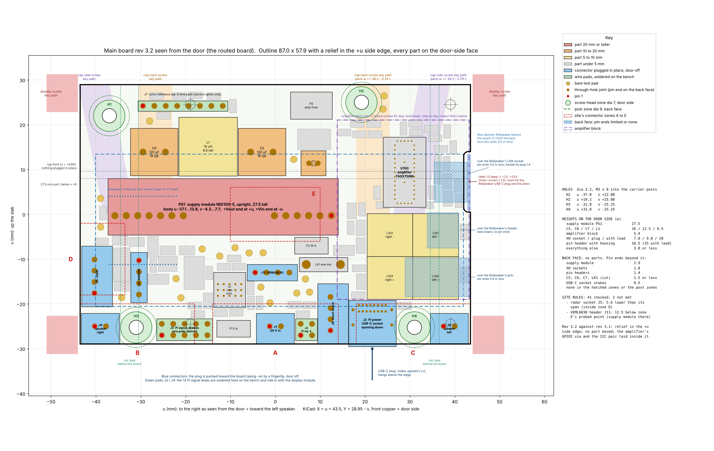
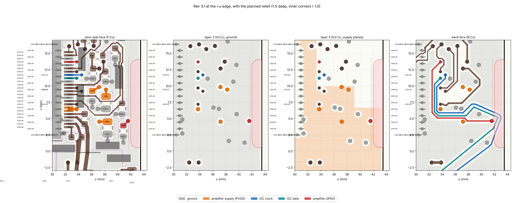
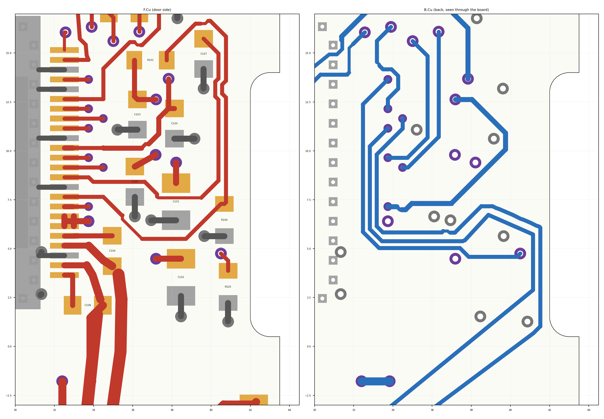

# Main board rev 3.2 — the relief in the side edge (2026-11-14)

Electronics session, brief `claude/brief-electronics-rev3-2-2026-11-13.md` (amended 2026-11-14). Positions are in the
site's board frame, seen from the door: **u** to the right (toward the left speaker), **v** up, mm.
Block 0 (what was in the way, and Daniel's decision): `block0.md`. The reply to the enclosure:
`../main-board-rev3-2-reply-2026-11-14.md` (also `claude/main-board-rev3-2-reply-2026-11-14.md` in the project).

**The board is changed and checked. It is a draft like everything else until the whole unit is shown to be printable
and buildable. No fab files, no stencil, no basket or order list touched, nothing on `main`.**

## 1. Answer
- **Rev 3.2 is `../main-board.kicad_pcb`.** Rev 3.1 is kept as `../rev3.1/main-board-rev3.1.kicad_pcb` (and in commit
  `110497a`), with its reports, pictures, schematic PDF and `MAIN_env.md` in `../rev3.1/`.
- **The relief:** floor at u +42.0 from v +1.5 to +13.0, **1.5 deep** over the whole span; inner corners drawn at
  **r 1.0** (centres (+43.0, +1.5) and (+43.0, +13.0)), so the side walls are at v +0.5 and +14.0. 19.82 mm² cut away.
- **Copper keeps 0.30 from the new edge** (the board's copper-to-edge rule; JLC's limit 0.2).
- **No part moved.** What moved for the relief (Daniel's decision of 2026-11-14, `block0.md`): the amplifier's GPIO2
  via and its two short tracks, the I2C pair's loop on the back face, and the four pours at the edge.
- **Schematic check: 0 errors, 0 warnings. Board check with schematic comparison: 0 errors, 0 open connections,
  0 differences, 2 warnings** (the same two as rev 3.1: the USB-C socket's and the touch socket's footprints differ
  from KiCad's library copies, by design).
- **Site rules: 41 checked, 39 met, 2 not met** (the two accepted with the rev 3 floor plan). Five rules added for the
  relief, all met.
- **Supply copper: the figures of rev 3.1, to the hundredth.** Amplifier supply: fuse to chip unchanged.

## 2. What changed, old → new
| What | Rev 3.1 | Rev 3.2 |
|---|---|---|
| Outline, +u side edge | straight, u +43.5 | **relief: u +42.0 over v +1.5 … +13.0**; side walls v +0.5 and +14.0 from u +43.0; inner corners r 1.0; corners at the old edge square |
| GPIO2 via (amplifier strap line to R105), 0.6 / 0.3 | (+41.585, +4.589) | **(+40.500, +4.750)**: 1.085 toward −u, 0.161 up |
| GPIO2 stub, door side, 0.2 | R105.1 (+40.867, +3.870) → old via, 1.02 | R105.1 → (+40.867, +4.383) → new via, 1.03 |
| GPIO2 track, back face, 0.2 | old via → (+37.862, +4.589), 3.72 | new via → (+40.339, +4.589) → (+37.862, +4.589), 2.71 |
| I2C clock, back face, 0.2 | ten pieces from (+41.52, +1.02) out to u +42.97 and back to (+41.47, +6.12), 6.29 | (+41.52, +1.02) → (+41.52, +6.07) → (+41.47, +6.12), 5.12 |
| I2C data, back face, 0.2 | long run (+17.825, −16.225) → (+41.875, +3.475); turn → (+42.525, +5.125); return run → (+38.875, +6.725) | long run on the same line to (+41.150, +2.881); straight to (+41.150, +5.728); return run on its old line from there |
| Amplifier supply plane PVDD, layer 3 | 814.09 mm² | 804.81 mm² (8.81 off its corner at u +41.58 … +43.20, v +0.08 … +6.60; 1.14 round the via's new place; 0.67 back at its old place) |
| Ground pours: door side / layer 2 / back | 3018.91 / 4489.33 / 3347.36 mm² | 2996.41 / 4468.89 / 3331.06 mm², all changes at u +39.77 or more |
| Board area | 5037.30 mm² | 5017.48 mm² |
| Track length / vias | 2126.1 mm / 245 | 2122.6 mm / 245 |
| Revision text on the back; title blocks | REV 3.1 2026-11-11 | REV 3.2 2026-11-14 (board and the five schematic sheets) |

- Nothing else: the 120 parts and their pads to 0.000, the other 2078 mm of track (by piece; the data line's 31 mm run
  from the lower left is counted as taken out, though it was laid again on its own line, 0.94 shorter), the other
  244 vias, the other five pours (`check/compare_rev31_result.txt`; away from the relief the pours differ by under
  0.0001 mm², rounding where that run was shortened).
- **Heights:** none changed.

## 3. Supply copper
Same method as rev 3.1 (`../rev3.1/check/pi5v_board.py`, `rnet.py`).

| Path, board copper at 20 °C | Rev 3.1 | Rev 3.2 |
|---|---|---|
| Pi 5 V: module → fuse / fuse → link / link → socket / return | 1.02 / 0.53 / 2.24 / 1.03 mΩ | the same |
| Pi 5 V board copper | 4.82 mΩ | 4.82 mΩ |
| 20 V: socket → fuse / fuse → protection chip / chip → filter coil / coil → module | 1.06 / 0.99 / 3.68 / 5.27 mΩ | the same |
| Amplifier supply: fuse F5 → the chip's five PVDD pins | 7.564 mΩ | 7.564 mΩ |
| Amplifier supply: fuse F5 → its bulk capacitors C100–C102 | 8.855 mΩ | 8.875 mΩ (+0.02: the via's new clearance hole in the plane, next to C102) |

`check/pi5v_rev3.2_result.txt`, `check/pvdd_path.py`, `check/pvdd_path_result.txt`.

## 4. Checks, with the numbers
| Check | Result | Where |
|---|---|---|
| Schematic check | 0 errors, 0 warnings | `../erc-report.txt` |
| Board check with schematic comparison | 0 errors, 0 open, 0 differences, 2 warnings (as rev 3.1) | `../drc-report.txt` |
| Site rules | 41 checked, 39 met, 2 not met (accepted, as on rev 3.1) | `site-rules.md` |
| Relief | 1.500 deep at all 231 points over v +1.5 … +13.0 of the board's own outline | rule 37 |
| Rest of the outline | every corner on the 87.0 × 57.9 rectangle or in the relief; 19.82 mm² cut | rule 38 |
| Nothing in the relief | courtyards: R105 0.36, R100 0.55 from the floor; pads: R105 0.66 | rule 39 |
| Display power lead's strip on the back (u −15 … −9, v −21 … +14) | no through-hole joint; nearest C5's lead 2.50 outside | rule 40 |
| Against rev 3.1 | 0 of 120 parts moved, 0 pads moved | rule 41 |
| Copper to the new edge | pours 0.30 along the floor (0.298 at the rounded corners on the stored fill polygon: arc approximation, KiCad's check passes); I2C clock 0.38; R105's pads 0.66; I2C data 0.75 | `check/compare_rev31_result.txt` |
| STEP file read back | relief, holes, 85 bodies identical to rev 3.1's file, plug envelopes identical: all agree | `check/step_check_result.txt` |
| Hand assembly | all parts on the door side; nothing under 0603; connectors through-hole (as rev 3.1) | `check/hand_assembly_rev3.2_result.txt` |
| Repeatable | a second run of `../gen/rev32.py` gives the same tracks, vias, pours and outline | — |

## 5. Deviations from the brief
1. **Two pieces of amplifier copper changed** (the supply plane's corner, the GPIO2 via and its two tracks): asked at
   block 0, decided by Daniel (option 1), `block0.md`.
2. `rev3.1/supply-copper.md`, named in the brief's inputs, does not exist; the supply copper of rev 3.1 is in
   `../rev3.1/README.md` section 5. Recalculated here (section 3).
3. A scratch trial was made in block 0 to show that 1.5 works before asking.
4. The plug envelopes are not issued again: written with rev 3.2 they are the same seven blocks as
   `../main-board-rev3.1-plug-envelopes.step`, which stands.
5. `../gen/plotcu.py` now draws the board's own outline instead of a fixed rectangle (for the relief); it draws rev 3.1
   as before.
6. The pictures in the folder above (`../main-board-3d-door-side.png`, `../main-board-3d-back.png`,
   `../main-board-copper-F-B.png`) are now rev 3.2's; rev 3.1's are in `../rev3.1/`.

## 6. Open, listed and not done (carried from rev 3.1 unless marked)
1. The board file has no stack-up set; it has to be set when the fab files are made.
2. 53 of 120 part names are hidden on the silkscreen; the assembly drawing has to carry them.
3. The assembly and bring-up text in `../README.md` and section 7 of `../NOTES.md` still describe rev 2.1.
4. Two test pads moved on rev 3.1 (inlet current TP3, radar supply TP12); the bring-up text names them, not their places.
5. **New:** the outline tolerance at JLC is ±0.2 for regular routing (±0.1 precision), so the relief's floor lands
   at u +41.8 … +42.2. Which routing to order is for the parts list; nothing on the board changes for it.

## 7. Files
| File | What |
|---|---|
| `../main-board.kicad_pcb`, five `.kicad_sch` | rev 3.2 (the schematic changed in its title blocks only) |
| `../gen/rev32.py`, `rev32-run.txt` | the change, as a script, and the log of the run that made the board |
| `../erc-report.txt`, `../drc-report.txt`, `../main-board-schematic.pdf` | checks and schematic of rev 3.2 |
| `../main-board-rev3.2.step` | the populated board (rev 3.1's files kept) |
| `../MAIN_env.md` | outline, holes, heights, back face for rev 3.2 |
| `floorplan.json`, `floorplan.png`, `site-rules.md`, `floorplan-tables.md` | the plan read back from the board (with the outline polygon and the relief), and the site check |
| `plan_from_board.py`, `sitecheck.py`, `sitedata.py` | how they are made |
| `block0.md`, `check/block0_inventory.py`, `check/block0_inventory_rev3.1_result.txt` | block 0 |
| `check/` | comparison with rev 3.1, supply copper, STEP read-back, hand assembly, the plotting scripts |
| `edge-rev3.1-planned.png`, `edge-rev3.2.png`, `copper-edge.png` | the edge before and after |
