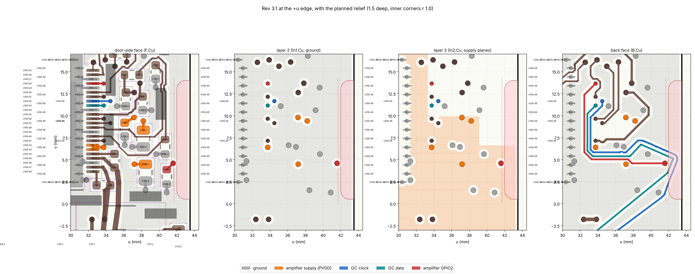

# Report — Electronics session, main board rev 3.2, block 0 — 2026-11-14

Brief: `claude/brief-electronics-rev3-2-2026-11-13.md` (amended 2026-11-14). Board: rev 3.1, `hardware/main-board/main-board.kicad_pcb` on `docs` (head `39ef103`; nothing under `hardware/` had changed since `110497a`). Board frame of the site document, seen from the door: **u** to the right (toward the left speaker), **v** up, mm; the side edge is at u +43.5. Block 0 changed nothing on the board; the trial below was a scratch copy in the session's workspace. (Also in the project as `claude/report-electronics-rev3-2-block0-2026-11-14.md`.)

**Decided by Daniel on 2026-11-14 (morning), option 1: 1.5 deep as tried, with both changes to amplifier copper.** Blocks 1 and 2 followed: `README.md` in this folder.

## 1. Answer
- **1.5 deep is possible.** A scratch copy with the relief passes KiCad's board check with schematic comparison: 0 errors, 0 open connections, 0 differences, the same 2 warnings as rev 3.1.
- **It changes two pieces of amplifier copper, so I stopped here as the brief says:**
  1. **The amplifier's supply plane** (PVDD, layer 3) reaches the edge in the relief's span. Its corner has to follow the new edge: 814.1 → 804.8 mm² (−1.1 %). The part that goes lies beyond every PVDD pad and via (the outermost, C102's pad, ends 2.4 inside it), so no supply current runs through it.
  2. **The via of the amplifier's GPIO2 strap line** (to its pull-down resistor R105) moves **1.10 toward the middle**, beside its pad. Without that, the I2C pair that loops round the via cannot be laid inside the new edge.
- **A shallower relief does not avoid either.** At 1.0 deep the plane's corner still goes and the via still has to move (0.38 at least).
- **Nothing else moves:** no part, no supply track or area, no other amplifier track.

## 2. What is within 2.5 of the edge, v 0 … +14.5 (rev 3.1)
Region u +41.0 … +43.5. "Gap to 1.5" is the smallest distance to a 1.5 relief drawn as in section 4; copper needs 0.30.

| Layer | Item | Reaches u | Over v | Gap to 1.5 / 1.25 / 1.0 |
|---|---|---|---|---|
| Door-side face | ground pour | +43.20 | 0 … +14.5 | 0 / 0 / 0 (it follows the edge) |
| Door-side face | R105 pads (0603, GPIO2 pull-down) | +41.34 | +1.82 … +4.27 | 0.66 / 0.91 / 1.16 |
| Door-side face | R100 pads (0603, speaker gain) | +41.15 | +5.24 … +7.69 | 0.85 / 1.10 / 1.35 |
| Door-side face | GPIO2 stub, pad to via, 0.2 | +41.68 | +3.86 … +4.69 | 0.32 / 0.57 / 0.82 |
| Door-side face | ground track R105 to its via, 0.3 | +41.02 | +1.20 … +2.29 | 0.98 / 1.23 / 1.48 |
| Door-side face | part outlines (courtyards) R105, R100 | +41.59, +41.40 | +1.57 … +7.94 | 0.41 / 0.66 / 0.91 at the nearest |
| Door-side face | silkscreen of R105, R100 | +41.45, +41.26 | +2.75 … +6.76 | 0.55 / 0.80 / 1.05 at the nearest |
| Layer 2 | ground plane | +43.20 | 0 … +14.5 | 0 / 0 / 0 (it follows the edge) |
| Layer 3 | **amplifier supply plane PVDD** | +43.20 | **0 … +6.60** (its corner) | 0 / 0 / 0 |
| Back face | ground pour | +43.20 | 0 … +14.5 | 0 / 0 / 0 (it follows the edge) |
| Back face | **I2C clock and data, 0.2: a loop round the GPIO2 via** | **+43.07** | +0.4 … +6.4 | 14 pieces 0 to 0.08 / 12 pieces / 11 pieces |
| Back face | GPIO2 track, 0.2 | +41.68 | +4.49 … +4.69 | 0.32 / 0.57 / 0.82 |
| All layers | **GPIO2 via, 0.6** at (+41.59, +4.59) | +41.88 | +4.29 … +4.89 | 0.12 / 0.37 / 0.62 |
| All layers | ground via of R105, 0.6, at (+40.87, +1.27) | +41.17 | +0.97 … +1.57 | 0.85 / 1.09 / 1.34 |
| Back-face silkscreen | none in the region | | | |

Script and full list: `check/block0_inventory.py`, `check/block0_inventory_rev3.1_result.txt`.

## 3. Which depth, and what has to move
- **The I2C pair must come in at every depth.** Its loop runs out to u +43.07; copper may reach u +42.20 at 1.0 deep and u +41.70 at 1.5.
- **The GPIO2 via must move at every depth.** The pair has to pass outside it; two tracks of 0.2 with their gaps need the via's centre at u +41.20 or less for 1.0 deep (0.38 inward), +40.95 for 1.25 (0.63), +40.70 for 1.5 (0.88). Crossing the GPIO2 track on the door side instead, with four extra vias, does not fit: the gap between C102, R105 and R100 is about 0.9 wide.
- **The pours follow the new edge at every depth**, including the amplifier supply plane's corner.

**Old → new at 1.5 deep (as tried; rev 3.2 is the same, `README.md` section 2):**

| What | Rev 3.1 | Trial |
|---|---|---|
| GPIO2 via (amplifier net) | (+41.585, +4.589) | **(+40.500, +4.750)**: 1.10 inward, beside R105's pad |
| GPIO2 stub, door side | pad centre to the old via, 1.02 | pad centre straight up 0.51, then 45° to the via 0.52 |
| GPIO2 track, back face | old via to (+37.86, +4.59), 3.72 | new via 45° down 0.23, then along the old line 2.48 |
| I2C clock, back face | ten pieces out to u +43.07 between v +1.02 and +6.12 | **straight at u +41.52** from v +1.02 to +6.07, then 45° onto the old joint at (+41.47, +6.12); 1.17 shorter |
| I2C data, back face | long run to (+41.875, +3.475), turn out to (+42.525, +5.125), return run | long run on the same line, ending at (+41.15, +2.88); **straight at u +41.15** to (+41.15, +5.73); return run on its old line from there; 1.37 shorter |
| Amplifier supply plane, layer 3 | 814.09 mm² | 804.81 mm²: 8.81 off its corner (u +41.58 … +43.20, v +0.08 … +6.60), 1.14 round the via's new place, 0.67 back at its old place |
| Ground pours | door side 3018.91, layer 2 4489.33, back 3347.36 mm² | 2996.41, 4468.89, 3331.06 mm²: only next to the relief and the moved via |
| Board | 5037.30 mm² | 5017.48 mm² (19.82 cut away) |

Nearest copper to the new edge in the trial: the four pours 0.30, the I2C clock 0.38, R105's pads 0.66, the I2C data 0.75. Away from the relief and the via the pours are unchanged (differences under 0.0001 mm², rounding). A refill of unchanged rev 3.1 gives its pours to 0.000 mm², so the refill itself changes nothing.

## 4. The relief as tried
- **Floor at u +42.0 from v +1.5 to +13.0**: the full 1.5 over the whole span.
- **Inner corners drawn at radius 1.0**, centres (+43.0, +13.0) and (+43.0, +1.5), so the side walls are at v +14.0 and v +0.5 from u +43.0 to +43.5.
  - Why 1.0: the standard outline cutter at Eurocircuits and NextPCB is 2.0, leaving 1.0. JLC support has said it normally uses a 0.5 radius tool for internal cut-outs (techoverflow, 2023). An arc drawn at 1.0 is cut as drawn by either.
- **Copper keeps 0.30 from the new edge**: the board's copper-to-edge rule, which the pours already keep at every edge (`../../notes/jlc-fab.md`: JLC's limit 0.2).

## 5. Not touched
- Supply copper of rev 3.1 (`../rev3.1/README.md` section 5: the Pi's 5 V path, the 20 V inlet, 20 V into the supply module): no track or area changed. Recalculated in block 1: unchanged.
- The back-face strip for the display's power lead (u −15 … −9, v −21 … +14): nowhere near.
- Every part, the four holes, every connector, every part taller than 3.0; the left speaker socket.

## 6. Deviations
1. `rev3.1/supply-copper.md`, named in the brief's inputs, does not exist. The supply copper of rev 3.1 is in `../rev3.1/README.md` section 5 and the reply of 2026-11-11, section 10.
2. A scratch trial was made in block 0 (not pushed) to show that 1.5 works before asking.

## 7. Decision asked of Daniel, and his answer
**May the relief change the two pieces of amplifier copper above?**
1. **Yes, 1.5 deep as tried** (recommended) — **taken.**
2. Yes, but 1.0 deep: the same two changes (the via moves 0.38 instead of 1.10); 0.5 less room for the pliers.
