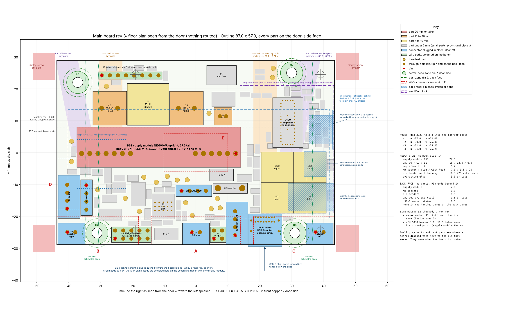

# Main board rev 3: change list and floor plan (2026-11-11)

Electronics session, step 2 of the agreed order of work (`claude/brief-electronics-step2-2026-11-10.md`), blocks 0 and 1.
Site: `claude/main-board-site-2026-11-10.md`, issue 2. All positions are in the site's board frame, seen from the door:
u to the right (toward the left speaker), v up, w out of the door-side face, mm.

**Blocks 0 and 1 (sections 1 to 13) were the floor-plan checkpoint. Block 2, the routed board, is section 14.
No fab files, no stencil, no basket or order list touched, nothing on `main`.**

## 1. Answer
- **The board fits the site.** Outline 87.0 x 57.9 (the largest allowed), 1.6 thick, 4 layers. All 120 parts of rev 2.1
  have a place on the door-side face. The back face carries no part.
- **32 site rules checked: 30 met, 2 not met.** Both are lead spans, and both come from the supply module (27.5 tall,
  50.8 long, only allowed below v +8):
  1. Radar socket: pins at v -17.6...-10.1, which is 5.6 lower than the lead's span v -12...-2. Still inside zone D.
  2. VEML6030 header: 11.5 below the point where zone E was probed, because the supply module stands on that point.
- **None of your standing decisions is touched.** One face of surface-mount parts, through-hole connectors, nothing
  smaller than 0603, every chosen part kept, the Pi powered over its own USB-C from this board, pre-made leads.
- **Against rev 2.1:** no connector type changes and no value changes. One part changes (the shared 2 x 4 sensor
  header becomes two 1 x 4 headers). The schematic changes in three places (section 3).
- **Picture:** `floorplan.png` in this folder.

## 2. What rev 2.1 does, and where each function goes (block 0)
| # | Function | Parts | Place on rev 3 |
|---|---|---|---|
| 1 | 20 V in, fuse, inlet protection (under- and over-voltage, current limit, soft start) | J1, F1, U1, C1-C4, R1-R6, D1 | bottom edge, middle (J1, F1); U1 and its parts above them, under the gap between the supply module's pin groups |
| 2 | 20 V filter in front of the supply module (Mean Well's circuit) | C5, L1, C6 | top left, in one row; C6 over the module's +Vin pins |
| 3 | 5 V supply | PS1 (NID100-5), C7, D2, R7, trim network R8/R9 (not fitted) | PS1 across the middle; C7 and D2 above its +Vout end |
| 4 | Pi power branch | F2, wire link LK1, J2 (USB-C socket), R10, R11, C8, C9 | straight down from the +Vout pins to the bottom edge |
| 5 | Radar branch | F3, C10, R19, J5 | -u side edge (zone D) and beside it |
| 6 | 3.3 V regulator and the sensor branch | U2, R12, C11, C12, R13, F4 | left of centre, below the supply module |
| 7 | Link to the Pi, 13 signal leads | J3 (9 leads), J4 (4 leads), R14-R18 | bottom edge, soldered on the bench |
| 8 | Sensor and touch connectors | J10 (BME680), J11 (VEML6030), J6 (touch) | J10 in zone D, J11 in the middle below the supply module, J6 on the bottom edge |
| 9 | Echo-reference links for the second option | J7 (8 wire pads), R20-R25 (not fitted) | top left, above the 20 V filter |
| 10 | Amplifier with output filters and speaker sockets | U100 (TAS5756M), F5, C100-C123, R100-R105, L100-L103, R26/R27, J8, J9 | one block down the +u side: chip on top, filters below, left speaker socket under it; right speaker socket in the opposite corner |
| 11 | Bench measuring points | 19 test pads, F5 pad 2 for the amplifier supply | door-side face, next to what they measure |
| 12 | Mounting | H1-H4 | four holes dia 3.2 near the corners |

## 3. Changes this site needs (block 0)
**In the schematic**
1. **Mounting holes H1-H4:** dia 2.7 for M2.5 becomes **dia 3.2 for the unit's standard M3 x 8**, at new positions (section 4).
2. **Sensor header split:** the shared 2 x 4 header J10 becomes **J10 (BME680, 1 x 4)** and **J11 (VEML6030, 1 x 4)**.
   Same four nets on each: 3.3 V, ground, SDA, SCL.
3. **Pi signal pads J3:** the nine leads are put in the order of the housings at the Pi, once the housing set is
   decided (decision 2). The nets do not change. `gpio-leads.md` follows in block 2.
4. Title block: rev 3.

**In the layout only (same schematic, same parts)**
5. The USB-C socket J2 and the wire link LK1 move from the back face to the **door-side face**. J2 keeps its mouth
   flush with the bottom edge and opens downward.
6. The 19 test pads move to the door-side face, so they can be probed with the board on its carrier.
7. The wire landings J3, J4 and J7 get their own footprints: pads only, no pin-header outline.
8. Speaker sockets: **left on the +u side (J8), right on the -u side (J9)**, lettered "SPK L" and "SPK R" with + marked.
9. The series positions for the audio clock and data lines (R14-R16) sit at the Pi signal pads.
10. Keep-out areas in the board file for the screw heads (dia 7, door side), the posts (dia 9, back face) and the zones
    behind which the ReSpeaker allows no pin ends.

**Not changed:** every value; all connector types (JST XH top entry, USB4085, pin headers, wire pads); the amplifier,
supply, inlet-protection and regulator circuits; the echo-reference links; the trim network; the fuses.

**Part changes for the parts list in step 5 (no basket touched):** one 2 x 4 pin header becomes two 1 x 4 pin headers;
four M2.5 board screws become four M3 x 8 (already counted in the architect log, section 10).

## 4. Outline and holes (block 1)
- **Outline:** rectangle 87.0 x 57.9, u -43.5...+43.5, v -28.95...+28.95, square corners. Nothing overhangs the top or
  side edges. At the bottom edge only J2's plug passes.
- **Holes:** four, dia 3.2, not plated. Clear round each: dia 7 on the door side (screw head), dia 9 on the back face (post).

| Hole | u | v | Band (site section 2) | Nearest display mounting point |
|---|---|---|---|---|
| H1 | -37.00 | +22.00 | top band v +18.0...+25.5 | 18.2 |
| H2 | +30.00 | +25.00 | top band v +18.0...+25.5 | 9.1 |
| H3 | -31.00 | -25.25 | bottom band v -25.25 +/- 0.2 | 12.1 |
| H4 | +31.00 | -25.25 | bottom band v -25.25 +/- 0.2 | 8.1 |

## 5. Connectors
Pin 1 is the red dot in the picture. "Box" is the part's outline on the board plus about 0.5 all round (wire pads: the pads plus 0.3).

| Ref | Lead | Type | Pin 1 (u, v) | Last pin (u, v) | Box on the board u | Box v | Mating | Plugged |
|---|---|---|---|---|---|---|---|---|
| J9 | Speaker right | JST B2B-XH-A, through-hole, top entry | -40.25, -25.00 | -37.75, -25.00 | -43.24...-34.76 | -28.95...-22.11 | plug toward the board (-w) | in place, door off |
| J3 | Pi signal leads, 9 (10 pads) | wire pads 2 x 5, 2.54 pitch, hole dia 1.0 | -25.30, -27.00 | -15.14, -24.46 | -26.45...-13.99 | -28.15...-23.31 | wires soldered | bench |
| J1 | 20 V from the inlet board | JST B2B-XH-A | -1.25, -25.00 | +1.25, -25.00 | -4.25...+4.25 | -28.95...-22.11 | plug toward the board (-w) | in place, door off |
| J4 | Pi signal leads, 4 | wire pads 2 x 2, 2.54 pitch | +5.65, -27.00 | +8.19, -24.46 | +4.50...+9.34 | -28.15...-23.31 | wires soldered | bench |
| J6 | Touch board | JST B4B-XH-A, long side along v | +12.30, -25.94 | +12.30, -18.44 | +9.40...+16.25 | -28.93...-15.45 | plug toward the board (-w) | in place, door off |
| J2 | Pi power | GCT USB4085-GF-A, through-hole, door-side face | +18.65, -20.34 | +24.60, -20.34 | +16.30...+26.95 | -29.50...-19.23 | plug upward (+v) into the bottom edge | in place, door off |
| J8 | Speaker left | JST B2B-XH-A | +37.50, -25.00 | +40.00, -25.00 | +34.51...+42.99 | -28.95...-22.11 | plug toward the board (-w) | in place, door off |
| J5 | Radar | JST B4B-XH-A, long side along v | -40.30, -17.60 | -40.30, -10.10 | -43.20...-36.35 | -20.59...-7.11 | plug toward the board (-w) | in place, door off |
| J10 | BME680 | 1 x 4 pin header 2.54, for a 1 x 4 Dupont housing | -34.30, -10.30 | -34.30, -17.92 | -36.12...-32.48 | -19.73...-8.48 | housing toward the board (-w) | in place, door off |
| J11 | VEML6030 | 1 x 4 pin header 2.54, for a 1 x 4 Dupont housing | -4.50, -12.00 | +3.12, -12.00 | -6.32...+4.93 | -13.81...-10.19 | housing toward the board (-w) | in place, cap held above, door off |
| J7 | Echo-reference tap to the ReSpeaker (second option only) | wire pads 1 x 8, 2.54 pitch | -29.50, +24.20 | -11.72, +24.20 | -30.65...-10.57 | +23.05...+25.35 | wires soldered | bench, only if the second option is built |

- **Order along the bottom edge from -u to +u:** speaker right, post, Pi signal 9, 20 V fuse, 20 V in, Pi signal 4,
  touch, Pi power, post, speaker left. This is the site's order.
- **The touch socket stands with its long side up the board.** That is how touch and the four Pi signal pads both fit
  inside u +4...+14 next to the 20 V socket.
- **Pi signal leads:** the pads are plain plated holes. The wires can enter from either face. I suggest from the back
  face (the display side, where the leads are headed) with the joint on the door side, so nothing lies across the
  sockets on the bottom edge. The enclosure chat decides with its routes.
- **Speaker pins:** J8 pin 1 = left +, pin 2 = left -. J9 pin 1 = right +, pin 2 = right -.

## 6. Supply module, 20 V filter, amplifier
- **Supply module PS1:** upright, long side along u. Body u -37.1...+13.8, v -4.3...+7.7, 27.5 tall. Pin row at v -0.3.
  The +Vout pins (u +4.9...+12.5) are at the +u end, above the Pi power socket; the +Vin pins (u -28.1 and -25.6) at the -u end.
  Between the two pin groups (u -20.5...-0.2) the board is free underneath for the 20 V supply and the signal lines.
- **20 V filter:** C6 (u -32.3...-21.7), L1 (u -21.5...-8.5), C5 (u -8.3...+2.3), all at v +8.6 and up. C5 and C6 are 16 tall.
- **Amplifier block:** u +13.8...+43.2, v -19.0...+21.0. It is rev 2.1's block turned a quarter turn clockwise as one
  piece, so its part-to-part distances are the ones already laid out once.
  - Chip U100 at u +24.1...+33.6, v +1.6...+17.3, output pins at its lower end.
  - Left-channel filter coils L100, L101 in the +u column (u +30.6...+40.8); right-channel coils L102, L103 in the inner
    column (u +20.4...+30.6); both columns v -19.0...+0.2.
  - Left speaker socket J8 directly below (12 mm of track). The right speaker's two tracks cross the board to J9 (about 73 mm).
- **Runs on the board** (pad to pad, measured along u plus along v):

| Run | From - to | Length |
|---|---|---|
| 20 V in to the inlet protection | J1.1 - F1.1 ; F1.2 - U1.1 | 13 |
| Inlet protection to the 20 V filter | U1.19 - C5.1 ; C5.1 - L1.1 ; L1.2 - C6.1 ; C6.1 - PS1.9 | 72 |
| 5 V to the Pi power socket | PS1.1 - F2.1 ; F2.2 - LK1.1 ; LK1.2 - J2.A9 | 33 |
| 20 V to the amplifier | C5.1 - F5.1 ; F5.2 - U100.6 | 55 |
| Speaker left, filter to socket | L100.2 - J8.1 | 12 |
| Speaker right, filter to socket | L103.2 - J9.1 | 73 |
| Bit clock, Pi pad to amplifier | J3.6 - U100.23 | 92 |
| Radar supply | F3.2 - J5.1 | 18 |

  For comparison, routed copper on rev 2.1 (so a little more than pad to pad): 110 on the amplifier's bit-clock net,
  87 and 106 on the two left-speaker nets, 14 and 14 on the right-speaker nets. Rev 3 swaps which speaker has the long run.

## 7. Heights on both faces
**Door side.** Everything not listed is 3.0 or lower.

| Part | What | u | v | Height w | Allowed there | Limit from | Source of the height |
|---|---|---|---|---|---|---|---|
| PS1 | NID100-5 | -37.4...+14.0 | -4.6...+8.0 | 27.5 | 28.9 | cap side-screw key path | NID100-SPEC 2024-10-30 (27.5 +/- 1) |
| C5 | 120u 63V | -8.3...+2.3 | +8.6...+19.2 | 16.0 | 33.0 | door | EEU-FR1J121B dia 10 x 16 (MAIN_env rev 2.1) |
| C6 | 120u 63V | -32.3...-21.7 | +8.6...+19.2 | 16.0 | 24.0 | cap back-screw key path | EEU-FR1J121B dia 10 x 16 (MAIN_env rev 2.1) |
| C7 | 22u 35V | +5.7...+11.3 | +8.6...+14.2 | 12.5 | 35.0 | door | Wurth 860160572003, 12.5 max (MAIN_env rev 2.1) |
| L1 | 15u SRR1260 | -21.5...-8.5 | +8.6...+21.7 | 6.5 | 32.0 | door | MAIN_env rev 2.1 (KiCad model: 6.0) |
| L100 | 10u | +30.6...+40.8 | -19.0...-9.4 | 5.4 | 40.0 | door | MAIN_env rev 2.1 (CODACA: body 5.1) |
| L101 | 10u | +30.6...+40.8 | -9.4...+0.2 | 5.4 | 33.0 | door | MAIN_env rev 2.1 (CODACA: body 5.1) |
| L102 | 10u | +20.4...+30.6 | -9.4...+0.2 | 5.4 | 35.0 | cap side-screw key path | MAIN_env rev 2.1 (CODACA: body 5.1) |
| L103 | 10u | +20.4...+30.6 | -19.0...-9.4 | 5.4 | 42.0 | door | MAIN_env rev 2.1 (CODACA: body 5.1) |
| J1 | 20 V in socket | -4.2...+4.2 | -28.9...-22.1 | 7.00 bare; 9.8 mated (JST); 20 with the lead bend | 51.0 | door | JST XH top-entry header, KiCad model (plug mated 9.8, JST catalogue) |
| J8 | speaker left socket | +34.5...+43.0 | -28.9...-22.1 | 7.00 bare; 9.8 mated (JST); 20 with the lead bend | 44.0 | door | JST XH top-entry header, KiCad model (plug mated 9.8, JST catalogue) |
| J9 | speaker right socket | -43.2...-34.8 | -28.9...-22.1 | 7.00 bare; 9.8 mated (JST); 20 with the lead bend | 46.0 | door | JST XH top-entry header, KiCad model (plug mated 9.8, JST catalogue) |
| J6 | touch board socket | +9.4...+16.2 | -28.9...-15.4 | 7.00 bare; 9.8 mated (JST); 20 with the lead bend | 48.0 | door | JST XH top-entry header, KiCad model (plug mated 9.8, JST catalogue) |
| J5 | radar socket | -43.2...-36.4 | -20.6...-7.1 | 7.00 bare; 9.8 mated (JST); 20 with the lead bend | 40.0 | door | JST XH top-entry header, KiCad model (plug mated 9.8, JST catalogue) |
| J10 | BME680 socket | -36.1...-32.5 | -19.7...-8.5 | 8.65 bare; about 16.5 with the housing (estimate); 25 with the lead bend | 41.9 | cap side-screw key path | pin header, KiCad model (with a Dupont housing about 16.5, estimate) |
| J11 | VEML6030 socket | -6.3...+4.9 | -13.8...-10.2 | 8.65 bare; about 16.5 with the housing (estimate); 25 with the lead bend | 47.0 | door | pin header, KiCad model (with a Dupont housing about 16.5, estimate) |
| J2 | Pi power socket | +16.3...+26.9 | -29.5...-19.2 | 3.46; the plug hangs below the edge | 48.0 | door | GCT drawing USB4085 rev B |

**Back face.** No parts. Pin ends of the through-hole parts:

| Part | Pin ends at u | at v | Beyond the back face | Allowed there | Zone | Basis |
|---|---|---|---|---|---|---|
| C5 | -5.5...-0.5 | +13.9...+13.9 | 1.5 | 4.0 | over the ReSpeaker | leads cut after soldering (assumed, to be kept to on the bench) |
| C6 | -29.5...-24.5 | +13.9...+13.9 | 1.5 | 4.0 | over the ReSpeaker | leads cut after soldering (assumed, to be kept to on the bench) |
| C7 | +7.5...+9.5 | +11.4...+11.4 | 1.5 | 4.0 | over the ReSpeaker | leads cut after soldering (assumed, to be kept to on the bench) |
| J1 | -1.2...+1.2 | -25.0...-25.0 | 1.9 | 12.0 | bottom band | post 3.48 below the seating plane (KiCad model of JST XH) - 1.6 |
| J2 | +17.3...+25.9 | -24.7...-20.3 | 0.5 | 4.0 | over the ReSpeaker | shell stakes 2.10, signal tails 1.60 (GCT drawing) - 1.6 |
| J3 | -25.3...-15.1 | -27.0...-24.5 | 1.5 | 12.0 | bottom band | wire pads: wire end or solder cone (assumed); the lead itself may leave this face |
| J4 | +5.7...+8.2 | -27.0...-24.5 | 1.5 | 12.0 | bottom band | wire pads: wire end or solder cone (assumed); the lead itself may leave this face |
| J5 | -40.3...-40.3 | -17.6...-10.1 | 1.9 | 4.0 | over the ReSpeaker | post 3.48 below the seating plane (KiCad model of JST XH) - 1.6 |
| J6 | +12.3...+12.3 | -25.9...-18.4 | 1.9 | 4.0 | over the ReSpeaker | post 3.48 below the seating plane (KiCad model of JST XH) - 1.6 |
| J7 | -29.5...-11.7 | +24.2...+24.2 | 1.5 | 5.0 | top band | wire pads (second echo-reference option only) |
| J8 | +37.5...+40.0 | -25.0...-25.0 | 1.9 | 12.0 | bottom band | post 3.48 below the seating plane (KiCad model of JST XH) - 1.6 |
| J9 | -40.2...-37.8 | -25.0...-25.0 | 1.9 | 12.0 | bottom band | post 3.48 below the seating plane (KiCad model of JST XH) - 1.6 |
| J10 | -34.3...-34.3 | -17.9...-10.3 | 1.5 | 4.0 | over the ReSpeaker | pin 3.11 below the seating plane (KiCad model) - 1.6 |
| J11 | -4.5...+3.1 | -12.0...-12.0 | 1.5 | 4.0 | over the ReSpeaker | pin 3.11 below the seating plane (KiCad model) - 1.6 |
| LK1 | +6.9...+14.5 | -11.2...-11.2 | 1.5 | 4.0 | over the ReSpeaker | wire cut after soldering (assumed) |
| PS1 | -35.8...+12.5 | -0.3...-0.3 | 2.9 | 4.0 | over the ReSpeaker | pins 4.5 long (NID100-SPEC) - 1.6 |

- **Pin protrusion I assume (brief, point 7):** XH sockets 1.9, pin headers 1.5, supply module 2.9, USB-C socket 0.5.
  Leads of C5, C6, C7 and the wire link are cut to 1.5 or less after soldering; that goes into the assembly notes.
- No through-hole joint stands over the ReSpeaker's header (bare board), over its jack (0.9 allowed), beside its USB
  plug (1.4) or inside a post zone. The part of the board in front of those zones holds the amplifier, which is
  surface-mount only.

**Plugs and their taller neighbours** (for the reach check in step 3):

| Connector | Plug top w | Nearest taller part | Its height | Gap between the boxes | Direction from the connector |
|---|---|---|---|---|---|
| J9 | 9.8 | J10 | 16.5 | 2.4 | above (+v) |
| J1 | 9.8 | J11 | 16.5 | 8.3 | above (+v) |
| J6 | 9.8 | J11 | 16.5 | 4.8 | above (+v) toward -u |
| J8 | 9.8 | PS1 | 27.5 | 26.9 | above (+v) toward -u |
| J5 | 9.8 | J10 | 16.5 | 0.2 | toward +u |
| J10 | 16.5 | PS1 | 27.5 | 3.9 | above (+v) |
| J11 | 16.5 | PS1 | 27.5 | 5.6 | above (+v) |

## 8. The plan against the site document, rule by rule
| # | Rule | Site doc | Result | Number |
|---|---|---|---|---|
| 1 | Outline no larger than 87.0 x 57.9 | 1 | met | outline 87.0 x 57.9 (u +/-43.5, v +/-28.95), four square corners |
| 2 | Nothing overhangs the side edges or the top edge | 3 | met | nearest courtyard to a side edge 0.26 inside; over: none |
| 3 | Bottom edge: only the Pi power plug passes it | 5 | met | J2's body ends flush with the edge (mouth at v -28.95); its courtyard margin reaches 0.55 past it; other parts past the edge: none |
| 4 | H1: hole dia 3.2 on an allowed post position | 2 | met | u -37.00, v +22.00 (top band v +18.0...+25.5); nearest display mounting point 18.2 away (7.0 needed) |
| 5 | H2: hole dia 3.2 on an allowed post position | 2 | met | u +30.00, v +25.00 (top band v +18.0...+25.5); nearest display mounting point 9.1 away (7.0 needed) |
| 6 | H3: hole dia 3.2 on an allowed post position | 2 | met | u -31.00, v -25.25 (bottom band v -25.25 +/- 0.2); nearest display mounting point 12.1 away (7.0 needed) |
| 7 | H4: hole dia 3.2 on an allowed post position | 2 | met | u +31.00, v -25.25 (bottom band v -25.25 +/- 0.2); nearest display mounting point 8.1 away (7.0 needed) |
| 8 | Door side: dia 7 clear round each hole (screw head) | 2 | met | nearest part courtyard 0.01 outside the dia 7 zone; inside: none |
| 9 | Back face: dia 9 clear round each hole (post): no through-hole joint | 2 | met | nearest through-hole pad 0.10 outside the dia 9 zone; inside: none |
| 10 | Door-side part heights within the table and under the cap-screw key paths | 1, 3 | met | smallest margins: PS1 27.5 tall, 28.9 allowed (cap side-screw key path); C6 16.0 tall, 24.0 allowed (cap back-screw key path); H2 1.6 tall, 12.7 allowed (cap side-screw key path); H1 1.6 tall, 15.1 allowed (cap side-screw key path) |
| 11 | Plug with its lead bend (20; Dupont housing 25) inside the allowed height | 1, 4 | met | J1 20 of 51; J8 20 of 44; J9 20 of 46; J6 20 of 48; J5 20 of 40; J10 25 of 42; J11 25 of 47 |
| 12 | Supply module upright below v +8 | 4 | met | module v -4.34...7.75 at its 12.0 maximum thickness, u -37.10...13.79 |
| 13 | Nothing that is plugged in place in the top third (above v +9.65) | brief, 5 | met | highest plugged connector: J5, top at v -7.11 |
| 14 | 20 mm plug-plus-bend only below v +18 | 4 | met | all plugged connectors end at v -7.11 or lower |
| 15 | Back face: through-hole pin ends within the allowed heights | 1 | met | smallest margins: PS1 2.9 of 4.0 (over the ReSpeaker); J5 1.9 of 4.0 (over the ReSpeaker); J6 1.9 of 4.0 (over the ReSpeaker); C5 1.5 of 4.0 (over the ReSpeaker) |
| 16 | No through-hole joint over the ReSpeaker's header, its jack, or beside its USB plug | 1 | met | joints in those zones: none |
| 17 | No part on the back face | standing decision | met | parts on the back face: none |
| 18 | J1 (20 V in) in A, u -5...+5 | 5 | met | pins u -1.25...+1.25, v -25.00...-25.00 |
| 19 | J8 (speaker left) in C, u +30...+43 | 5 | met | pins u +37.50...+40.00, v -25.00...-25.00 |
| 20 | J9 (speaker right) in B, u -43...-36 | 5 | met | pins u -40.25...-37.75, v -25.00...-25.00 |
| 21 | J5 (radar) in zone D, v -18...-2 | 5 | met | pins u -40.30...-40.30, v -17.60...-10.10 |
| 22 | J5 (radar) in the lead's own span inside D, v -12...-2 | 5 | **NOT MET** | pins u -40.30...-40.30, v -17.60...-10.10. Pins are 5.6 lower than the span: at v -12...-2 the plug would run into the end of the supply module (27.5 tall; the two outlines overlap by 0.1 along u, and its length is +/- 1). Inside zone D; the lead grows by about 6 mm |
| 23 | J6 (touch board) in A, u +5...+14 | 5 | met | pins u +12.30...+12.30, v -25.94...-18.44 |
| 24 | J10 (BME680) in D, v -18...-8 | 5 | met | pins u -34.30...-34.30, v -17.92...-10.30 |
| 25 | J11 (VEML6030) in E, as drawn (u -10...+10, v -6...+6; probed at u -0.5, v -0.5) | 5 | **NOT MET** | pins u -4.50...+3.12, v -12.00...-12.00. The supply module stands on E's probed point (it has to be below v +8 and is 50.8 long). The header is 11.5 lower, in the middle of the board between E and A; reach to be probed again in step 3 |
| 26 | J3 (Pi signal 9) in bottom edge, u -34...-14 | 5 | met | pins u -25.30...-15.14, v -27.00...-24.46 |
| 27 | J4 (Pi signal 4) in bottom edge, u +4...+13 | 5 | met | pins u +5.65...+8.19, v -27.00...-24.46 |
| 28 | J2 (Pi power) in C, u +15...+30, opening downward | 5 | met | pins u +18.65...+24.60, v -21.69...-20.34 |
| 29 | Order along the bottom edge from -u to +u | 5 | met | J9 -39.0 . J3 -20.2 . J1 +0.0 . J4 +6.9 . J6 +12.8 . J2 +21.6 . J8 +38.8  (posts at u -31.0 and +31.0) |
| 30 | Plugs at the lower corners inside u +/-47 | 3 | met | speaker sockets end at u +/-43.24; their plugs stand on the board, nothing hangs past the corner |
| 31 | No two parts overlap (courtyards) | hand assembly | met | overlaps: none |
| 32 | Everything of rev 2.1 has a place on the door-side face | brief | met | 120 parts placed; courtyards fill 3298 of 5037 mm2 (65 %); rev 2.1: 66 % over both faces |

**The two that are not met**
1. **Radar socket J5 (rule 22).** At the span v -12...-2 the plug would run into the end of the supply module (their
   outlines overlap by 0.1 along u, and the module's length has a tolerance of 1 mm). The socket is 5.6 lower, inside
   zone D, 3.3 below the module. The lead grows by about 6 mm.
2. **VEML6030 header J11 (rule 25).** Zone E was probed at u -0.5, v -0.5. The supply module has to stand below v +8
   and is 50.8 long, so it covers that point wherever it goes. The header is at u -4.5...+3.1, v -12.0: the middle of
   the board, 5.6 below the module and 8.3 above the 20 V socket.

Neither needs a dimension from the site. Both need the fingertip probe repeated with the new board in the model (step 3).

## 9. The brief's points
1. **Speakers:** left on +u (J8, zone C), right on -u (J9, zone B), both at the corners. Met.
2. **Radar and BME680 in zone D, VEML6030 in the middle; shared header split.** Done; see the two notes above.
3. **Pi signal leads:** 9 at u -25.3...-15.1 and 4 at u +5.7...+8.2, bottom edge, soldered on the bench. Housings at the Pi: decision 2.
4. **Pi power socket:** bottom edge, centre u +21.6, opening downward, door-side face. Met.
5. **20 V in** at u -1.25 / +1.25; **touch** at u +12.3. Met.
6. **Order along the bottom edge:** as the site asks, with the posts at u -31.0 and +31.0.
7. **Pin ends:** section 7.
8. **Echo-reference, second option:** it needs a lead of 8 wires from J7 (u -29.5...-11.7, v +24.2) to the ReSpeaker's
   empty XIAO pad rows, which lie behind the board at u -37.2...-21.9, v -11.2 and +4.1. About 40 mm. It is soldered on
   the bench and only if the bench tests choose the second option. The first option (the default) has no lead.
9. **Noise:**
   - Amplifier chip: in front of the ReSpeaker's upper +u corner. Output filter coils: in front of its +u end, over its
     jack and its speaker header (both unused). The left-channel coils stand in front of the +u mic lead's strip
     (u +34.5...+36.5).
   - Supply module: in front of the ReSpeaker's middle and -u part. Its pins 11 and 12 (2.9 beyond the back face) are
     in front of the -u mic lead's strip (u -34.5...-30.5), pin 13 is 1.3 beside it; the BME680 header's pins (1.5)
     are in front of it too.
   - Filter coil L1: u -21.5...-8.5, 9 mm from the -u strip.
   - Between these parts and the ReSpeaker: layer 2 of the board is one unbroken ground plane; the back copper layer
     is a ground pour stitched to it, carrying only the long low-current signal runs (I2C, audio clock and data, UART,
     status lines). The amplifier's outputs ahead of the filters stay on the door-side copper (rev 2.1 has one 1.4 mm
     hop on the back; it goes). The coils are shielded types (CODACA CSBA0850 moulded, Bourns SRR1260).
   - Not known: where the switching parts sit on the supply module, and whether the ReSpeaker's board has a ground
     plane. The bench test of the relocated mics (noise floor within 1 dB of the baseline, 0 clicks) is the check.
10. **Service:** 20 V, both speakers, Pi power, touch, radar, BME680 and VEML6030 are plugged from the door side, all
    below v -7. Test pads are on the door side too.
11. **Revision name:** rev 3.

## 10. Assumed or not verified
- Dupont housing on a pin header: about 16.5 high (estimate carried from `hardware/notes/harness.md`), 25 with the lead bend (my estimate).
- JST XH: socket 7.0 high and post 3.48 below the seating plane are from KiCad's model of the JST part; 9.8 mated is
  JST's catalogue figure. JST's own drawing could be read as text only, without its dimension labels.
- Supply module: which of its two faces carries the parts is not on Mean Well's drawing. The footprint puts the 8 mm
  side upward (+v) and the 4 mm side downward.
- Lead ends of C5, C6, C7 and LK1 cut to 1.5: an assembly instruction, not a property of the parts.
- The small parts and the test pads are where a search dropped them. Their places are provisional; the areas are real.
- Courtyards fill 65 % of the board (rev 2.1: 66 % over both faces, about 61 % on its part side). Routing will be
  tighter than rev 2.1. If it does not close, the first relief is moving status test pads to the back face (bench only).
- The amplifier block's copper from rev 2.1 can probably be carried over turned; that is for block 2 to show.

## 11. Decisions needed from Daniel
**Answered 2026-11-11:** 1 = top-entry sockets as drawn; 2 = three housings (1 x 3, 2 x 5, 2 x 3), he has them;
3 = go-ahead to route. The questions as they were put:

1. **Sockets for 20 V, speakers, touch and radar**
   1. Top entry, plug pushed toward the board: as drawn. Same JST parts as rev 2.1; their pin ends fall where the site
      allows 12 mm (bottom edge) or 4 mm. **Recommended.**
   2. Side entry on the bottom edge for 20 V and the speakers (plug pushed up along the board, lead hangs straight
      down). Each socket then takes 11.5 of board height instead of 5.75, its pins come out over the ReSpeaker, and the
      left speaker's pins end about 1 mm from the zone over the ReSpeaker's jack. One new part (JST S2B-XH-A, three pieces). Not drawn.
2. **Housings at the Pi** (the display's power lead keeps its own 1 x 3 on pins 2-4-6)
   1. Three housings: 1 x 3 on pins 1-3-5 (3.3 V, SDA, SCL), 2 x 5 on pins 7 to 16 (TXD, ground, RXD, bit clock, ground,
      mute; four places empty), 2 x 3 on pins 35 to 40 as before. **Recommended.** Needs one 1 x 3, one 2 x 5 and one
      2 x 3 housing from your stock.
   2. If you have no 2 x 5: 1 x 5 on the even pins 8 to 16 and 1 x 4 on the odd pins 9 to 15, with the 1 x 3 and the 2 x 3 as above.
3. **Go-ahead to route on this floor plan,** or what to move first.

## 12. For the enclosure chat (early notice; the full reply follows the routed board)
1. Post positions: section 4.
2. Fingertip probe to repeat with this board in the model: J11 (u -0.7, v -12.0), J5 (u -40.3, v -13.9),
   J10 (u -34.3, v -14.1), J6 (u +12.3, v -22.2). Taller neighbours: table in section 7.
3. Pi signal wires: which face they leave (section 5).
4. Pin ends in front of the -u mic lead's strip: supply module pins 11 and 12 at u -30.7 and -33.2, v -0.3 (2.9 beyond the
   back face); J10 at u -34.3, v -17.9...-10.3 (1.5).
5. One more lead row if the second echo-reference option is ever built: J7 to the ReSpeaker's XIAO pads, about 40 mm, bench.
6. The radar lead is about 6 mm longer than estimated; the VEML6030 lead ends 11.5 lower.

## 13. Files and checks
| File | What |
|---|---|
| `floorplan.png` | the picture |
| `floorplan.json` | every part: position, rotation, box, pads |
| `site-rules.md`, `floorplan-tables.md` | the tables above, as generated |
| `plan/main-board-rev3-plan.kicad_pcb` | KiCad 9.0.9 board with the footprints at their planned places; no copper |
| `sitedata.py` | the site document's numbers |
| `floorplan.py` | builds the plan (`python3 floorplan.py <rev 2.1 netlist> .`; netlist: `kicad-cli sch export netlist --format kicadsexpr -o rev21.net ../main-board.kicad_sch`) |
| `sitecheck.py` | checks the plan against the site and draws the picture (`python3 sitecheck.py .`) |

Checks run on 2026-11-11:
- `sitecheck.py`: 32 rules, 30 met, 2 not met (section 8).
- KiCad's own design-rule check on the plan board: 12 courtyard overlaps, every one against the library pin-header
  outline of a wire landing (J3, J4, J7) that has no header body; none between real parts. They go with change 7.
- Read back from the KiCad file, independent of the two scripts: outline 87.0 x 57.9; 120 footprints, none on the back;
  four holes dia 3.2 at the positions of section 4; no through-hole pad in a no-pin zone or post zone; amplifier pins
  1 to 5 (left channel) on the +u side.

## 14. Block 2: schematic, routed board, checks (2026-11-11)

**Checkpoint. The board is routed and passes KiCad's checks. No fab files, no stencil, no basket or order list touched.**

### 14.1 Answer
- **Routed on the approved floor plan; no part moved** (all 120 positions compared with `floorplan.json`).
- **Schematic check (ERC): 0 errors, 0 warnings.** **Board check (DRC) with schematic comparison: 0 errors, 0 open
  connections, 0 differences from the schematic, 2 warnings** (J2 and J6: their silkscreen outline is trimmed where it
  would cross the board edge, so they no longer match the library copy; the same kind of warning as on rev 2.1).
- **Hand-assembly rules kept:** every part on the door-side face; through-hole are the connectors, the supply module,
  the three electrolytic capacitors and the wire link; smallest surface-mount part 0603.
- **The 32 site rules stand as at the floor plan** (30 met; radar socket and VEML6030 header still to be re-probed by
  the enclosure chat), because no part moved. Two new points for the enclosure chat came out of routing: section 14.5.

### 14.2 Schematic, rev 3 (`main-board.kicad_sch` and four sheets, `main-board-schematic.pdf`)
| Change | Rev 2.1 | Rev 3 |
|---|---|---|
| Mounting holes H1 to H4 | M2.5 | 3.2 mm unplated holes for M3 x 8 into the posts |
| Sensor header | J10, 2 x 4, BME680 and VEML6030 together | J10 1 x 4 (BME680) and J11 1 x 4 (VEML6030) |
| Pi wire pads J3 | pads in header order | pads in the order of the three housings (`../gpio-leads.md`) |
| Wire pads J3, J4, J7 | pin-header footprints | own footprints: 1.0 mm plated holes, 1.7 mm pads, 2.54 pitch |
Nothing else changed: same nets, same values, same part numbers.

### 14.3 The board (`main-board.kicad_pcb`)
- 87.0 x 57.9 x 1.6, four layers: door side (parts and signals), ground plane, supply plane (+5 V, +20 V, amplifier
  supply), back (signals and ground). 1114 track pieces, 198 vias.
- **Amplifier block:** the rev 2.1 copper round the chip, the output filters and the decoupling is carried over
  unchanged, turned with the block (412 track pieces, 66 vias). One short hop of one amplifier output (before its
  filter coil) is on the back, as it was on rev 2.1; the rest of the four outputs is on the door side.
- **Right speaker:** the amplifier sits on the left-speaker side, so the right speaker's two conductors cross the board
  to J9. They run side by side on the back, 1.0 wide, under the supply module's pin row and down between the radar and
  BME680 connectors: 91 and 81 mm, one via each, about 0.09 ohm for the pair (0.4 wide for the last 3 to 4 mm at the
  filter, as on rev 2.1). Everything that crosses them is on the door side. Left speaker: 13 and 26 mm, 0.8 wide
  (0.4 for 4 mm).
- **Supply paths:** 20 V in 1.0 wide to the fuse, 0.6 to 0.8 into the protection chip (0.3 for a few mm at its
  pins), 0.8 to 1.8 into the supply module; 5 V for the Pi 1.5 to the wire link, then 2.0 and 1.4 on the back to the USB-C
  socket with a 0.6 neck into each supply pin pair. +5 V, +20 V and the amplifier supply are areas on the supply plane.
- **Mounting holes:** no track, via or poured copper within 3.5 of a hole centre on the door side (under the screw
  head) or within 4.1 on the back (under the post face). Exception H2: section 14.5.
- **Silkscreen:** part names for 72 of 120 parts on the door side (the rest have no free space next to them; the
  assembly drawing will carry them). On the door side also: RADAR, the + of the left-speaker socket and the board name.
  On the back, because the door side has no room beside those connectors: SPK L, SPK R, 20V IN, PI USB-C, PI 1-15,
  PI 35-40, TOUCH, ECHO, BME680, VEML6030, LINK, the + of the 20 V and right-speaker sockets, revision and date.

### 14.4 How it was routed
An autorouter outside the repository was not used. `gen/pcb_rev3.py` builds the board from the netlist and
`floorplan.json` and carries the amplifier copper over. `gen/route_rev3.py` lays the supply paths and the right
speaker pair as planned tracks, then routes every other connection with the repository's grid router
(`gen/mroute.py`, search core replaced by a compiled one in `gen/fastgrid.py`), takes out and re-routes nets that
block others, removes unused stubs, pours ground on both outer layers and adds stitching vias. `gen/rev3_route.sh`
runs it end to end. The result is checked by KiCad, not by the scripts. Tracks are any-angle, not tidy 45 degree
runs: correct, but not pretty.

### 14.5 New for the enclosure chat (to go into the block 3 reply)
1. **H2 (u +30.0, v +25.0), back face:** the amplifier block's own tracks and two vias lie under the outer part of the
   post face, 2.9 to 3.7 from the hole centre (post face radius 4.0). They are under solder mask and the post is
   plastic. Options: 1. leave it (recommended); 2. relieve the H2 post face to 5.5 diameter; 3. re-route that corner
   of the amplifier block.
2. **H2, door side:** two of the amplifier's vias start 3.39 from the hole centre, so the copper-free circle under
   the screw head is 3.3 radius there instead of 3.5. A pan-head M3 (head up to 6.6 diameter) clears it; a 7 mm
   washer would not.

**Answered by Daniel 2026-11-11:** point 1: the enclosure chat is asked to make the H2 post face no larger than 5.5
across (the nearest amplifier track starts 2.9 from the hole centre; the request goes into the block 3 reply).
Point 2: M3 pan head, no washer, at all four posts.

### 14.6 Not done in this block
- Fab files, stencil, assembly drawing, bill of materials: not in this step.
- Height zones for both faces, connector table with plug envelopes, STEP export: block 3.
- `NOTES.md` sections 1 to 6 (values and their sources) are unchanged and still valid; its layout section 7 describes
  rev 2.1.

### 14.7 Files
`../main-board.kicad_pro`, `.kicad_sch` (five), `.kicad_pcb`; `../erc-report.txt`, `../drc-report.txt`;
`../main-board-schematic.pdf`; `../main-board-copper-F-B.png`, `../main-board-3d-door-side.png`,
`../main-board-3d-back.png`; `../gpio-leads.md`; `../gen/` (generators); `../rev2.1/` (the rev 2.1 files as issued).

